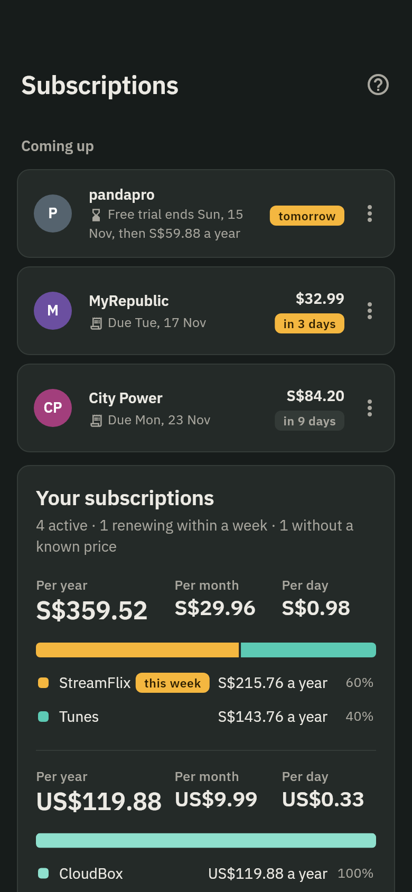
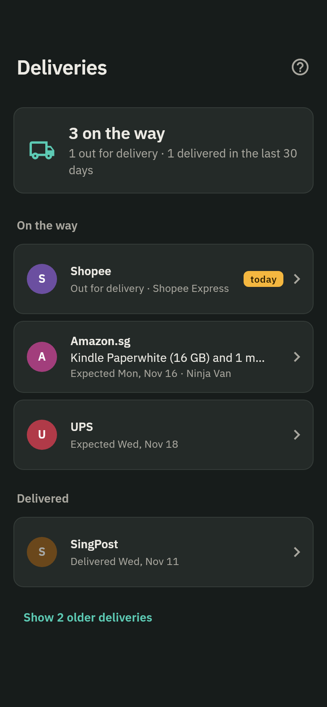
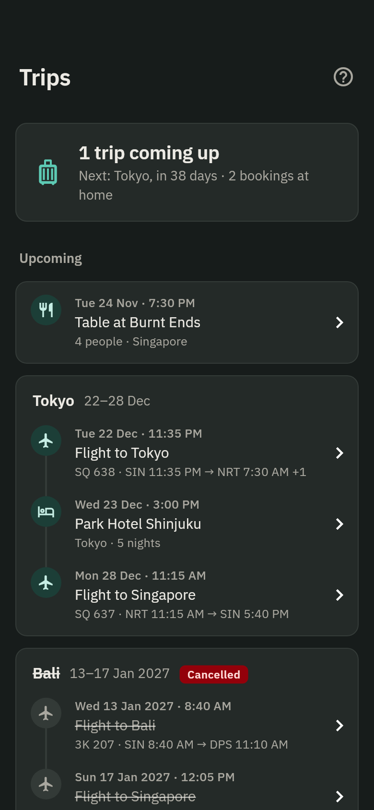
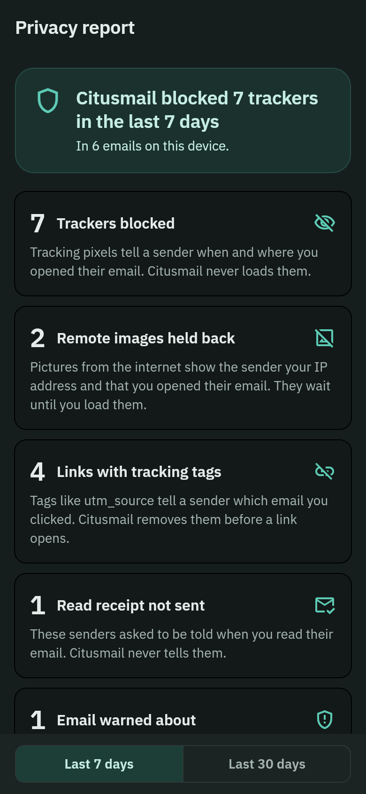
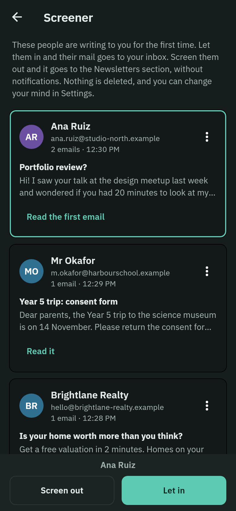
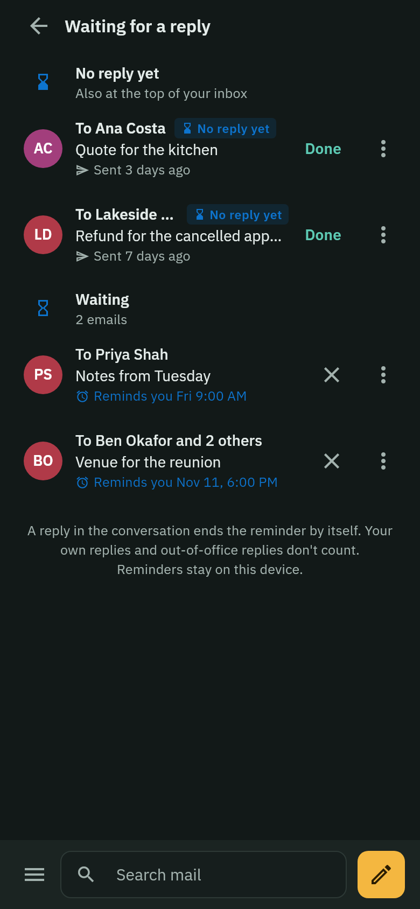
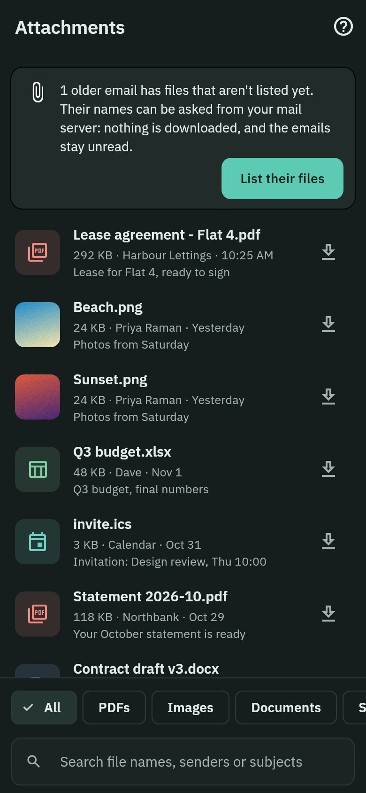
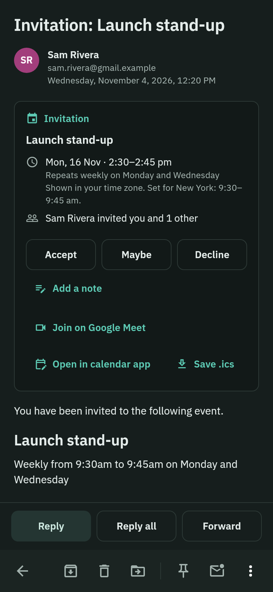

# Citusmail

**Fast, private email that stays yours.** A free, open-source mail app for
Linux, Windows and Android. No ads, no subscriptions, no tracking.

Website: **https://citusmail.fluminaris.com** · Download:
[latest release](https://github.com/pawtaetoe/Citusmail/releases/latest)

> 🔒 **Everything happens on your device.** Citusmail has no server, no
> account and no cloud. It connects only to your own mail provider:
> sorting, phishing checks, finding subscriptions, deliveries and trips
> all run on your phone or computer, and your mail is stored encrypted.
> Anything else (loading an email's images, one-click unsubscribe,
> optional link checks) happens only when you tap it or turn it on.
> [Exactly what leaves your device](PRIVACY.md)

<p align="center">
  
  &nbsp;
  
</p>

## What it does

- **Smart Inbox**: mail sorted into Pinned, Verification, Important,
  General, Notifications and Newsletters, with what came while you were
  away on top. Sign-in codes show in the list,
  copied with a tap, and in the notification.
- **Finds things in your mail for you**: subscriptions and what they cost,
  bills and trials coming up, deliveries, return-by dates, trips and the
  online accounts you have.
- **Phishing warnings that explain** what's wrong: forged senders,
  lookalike links, outsiders writing in your company's name.
- **Privacy by default**: images and trackers blocked, read receipts
  never sent, tracking removed from links, one-tap unsubscribe.
- **Inbox tools**: Snooze, Send later, "remind me if no reply", a
  Screener for new senders, clean-up of busy senders, every attachment
  under Files in search, and old codes tidied away.
- **Every account in one inbox**: Gmail, Outlook / Microsoft 365 and any
  IMAP provider.
- **A calm sidebar**: each account folds away with its unread count in
  sight, and what was found in your mail and the Tools (Clean up, the
  Privacy report) sit apart, folded until you need them.
- **Locked down**: encrypted storage, passwords in the system keychain,
  app lock with PIN or fingerprint, end-to-end encrypted sync between
  your devices.

## A look around

<table>
<tr>
<td align="center" width="25%"><br><sub>Subscriptions and what they cost</sub></td>
<td align="center" width="25%"><br><sub>Bills and trials coming up</sub></td>
<td align="center" width="25%"><br><sub>Deliveries</sub></td>
<td align="center" width="25%"><br><sub>Trips</sub></td>
</tr>
<tr>
<td align="center" width="25%"><br><sub>What was kept from senders</sub></td>
<td align="center" width="25%"><br><sub>Screener for new senders</sub></td>
<td align="center" width="25%"><br><sub>Remind me if no reply</sub></td>
<td align="center" width="25%"><br><sub>Every attachment in one list</sub></td>
</tr>
<tr>
<td align="center" width="25%"><br><sub>Meeting invitations</sub></td>
<td align="center" width="25%"><br><sub>Phishing warnings that explain</sub></td>
<td align="center" width="25%"><br><sub>Writing, with Send in thumb reach</sub></td>
<td align="center" width="25%"><br><sub>Plain settings</sub></td>
</tr>
</table>

<p align="center">
  
</p>

## Status

All planned features are built. Live checks against real Outlook and
Gmail accounts are still to run. The roadmap is in [PLAN.md](PLAN.md).

## For developers

Pure Dart mail protocols (IMAP, SMTP, MIME) written from scratch, a
Flutter app, and strict rules checked in CI: no analytics, every
dependency reviewed, and network code only in a few reviewed packages. See [SECURITY.md](SECURITY.md),
the [privacy policy](docs/privacy-policy.md) and the
[terms of service](docs/terms-of-service.md).

<details>
<summary><b>Building and testing</b></summary>

Requirements: Flutter (stable, version pinned in
[.github/actions/setup-flutter/action.yml](.github/actions/setup-flutter/action.yml)).
Linux builds also need `clang ninja-build libgtk-3-dev libsecret-1-dev
liblzma-dev libsqlcipher-dev`.

```bash
flutter pub get                               # resolve the whole workspace
dart run repo_tools:check_dependencies        # dependency policy
dart run repo_tools:check_imports             # no network libraries in shipped code
dart format --set-exit-if-changed .           # formatting
flutter analyze                               # static analysis
(cd packages/mail_protocol && dart test)      # protocol tests
(cd packages/mail_store && dart test)         # storage tests
(cd packages/mail_compose && dart test)       # writing and sending
(cd packages/mail_sync && dart test)          # sync engine unit tests
(cd packages/mail_setup && dart test)         # account setup unit tests
(cd packages/mail_sort && dart test)          # sorting rules
(cd packages/mail_extract && dart test)       # schema.org data in mail
(cd packages/mail_view && dart test)          # safe mail display
(cd packages/mail_trust && dart test)         # phishing checks
(cd packages/mail_web && dart test)           # hardened HTTPS for one-click unsubscribe
(cd packages/mail_unsubscribe && dart test)   # unsubscribe methods
(cd packages/mail_appsync && dart test)       # app data sync format and encryption
(cd packages/mail_oauth && dart test)         # OAuth sign-in
(cd packages/mail_lookup && dart test)        # Safe Browsing and VirusTotal clients
(cd tool && dart test)                        # repository tool tests
(cd app && flutter test)                      # app tests
(cd app && flutter run -d linux)              # run on Linux
(cd app && flutter run --flavor github)       # run on Android (or --flavor play)
```

The screens above are rendered from made-up mail:
`cd app && SCREEN_OUT=../docs/screenshots flutter test screenshots/screens_test.dart --plain-name readme`.
The gallery's feature screens come from the same file's feature scenes
(`deliveries`, `trips`, `privacy report`, `subscriptions coming up`,
`screener`, `follow-ups`, `attachments`, `invitation`), copied as
`readme_<name>.png`.

Windows builds need a Windows machine; CI builds them on every push.
Packages (.apk, Google Play .aab, .deb, Flatpak, Windows installer) and
release signing:
see [packaging/README.md](packaging/README.md).

Integration tests use local test mail servers; see
[test-server/README.md](test-server/README.md):

```bash
test-server/citusmailtest up && test-server/citusmailtest smoke
```

</details>

<details>
<summary><b>Live checks against a real account</b></summary>

To check behaviour against a real provider, put your account settings (never
the password) in a git-ignored `live-test.env`, and the password in the
system keychain:

```bash
cp live-test.env.example live-test.env          # then edit it
secret-tool store --label="Citusmail test account" service citusmail-test account you@example.com
scripts/live-account-check.sh                   # read-only: TLS, capabilities, folders (curl; password accounts)
dart run repo_tools:live_check                  # read-only: same, using the app's own IMAP/SMTP code
dart run repo_tools:live_check --send           # also sends one message to the account itself
```

For an Outlook account, set `LIVE_SIGN_IN=microsoft` and
`LIVE_OAUTH_CLIENT_ID` (the app registration from
[packaging/README.md](packaging/README.md)) instead of a password. For
Google sign-in, `LIVE_SIGN_IN=google` with a Google client ID, and its
client secret in the keychain:
`secret-tool store --label="Citusmail test OAuth client" service citusmail-test-oauth-client account <client id>`. The first
run opens the browser to sign in; the tokens are then kept in the keychain
(service `citusmail-test-oauth`) and the check renews them as the app does.
`--sign-in-again` forgets them and signs in afresh.

</details>

<details>
<summary><b>Repository layout</b></summary>

```
.
├── app/                      Flutter app (UI, platform code)
│   ├── lib/
│   └── test/
├── packages/
│   ├── mail_appsync/         App data shared between your devices, end-to-end
│                             encrypted (ChaCha20-Poly1305, sync code)
│   ├── mail_compose/         Writing mail: drafts, replies, sending with undo
│   ├── mail_extract/         schema.org data in shop and carrier mail (JSON-LD,
│                             microdata): parcels and orders, never run
│   ├── mail_lookup/          Optional outside checks, off until turned on: Google
│                             Safe Browsing (lists on the device, prefixes only)
│                             and VirusTotal (your key; file hashes, no uploads)
│   ├── mail_oauth/           OAuth 2.0 sign-in (Outlook, Google): PKCE, browser, tokens
│   ├── mail_protocol/        Pure Dart charsets, MIME, IMAP, SMTP and
│                             ManageSieve, written from scratch with no
│                             runtime dependencies
│   ├── mail_setup/           Account setup: discovery (Gmail built in) and
│                             login verification
│   ├── mail_sort/            Sorting into General, Verification codes,
│                             Newsletters, Notifications (header rules, plus
│                             what each sender's mail shows); finding codes
│   ├── mail_store/           Encrypted local storage (SQLite3MultipleCiphers)
│   ├── mail_sync/            Sync engine and background worker: folders, messages,
│                             offline queue, IDLE, opening messages, older mail
│   ├── mail_trust/           Phishing checks on the device: sender verification,
│                             lookalike domains, deceptive links, risky files
│   ├── mail_unsubscribe/     Unsubscribing: one-click (RFC 8058), email, web page
│   ├── mail_view/            Safe display: HTML and text to a document that
│                             cannot load anything; attachment names
│   └── mail_web/             The only HTTPS to servers named in mail: public
│                             addresses only, no cookies, no redirects
├── assets/icon/              App icon (SVG and PNG sizes)
├── docs/                     Privacy policy and terms (the website shows them)
│   └── screenshots/          Demo screens for this README and the website
├── packaging/                Linux .deb and Flatpak, Windows installer, signing
├── test-data/mail/           Sample emails shared by tests and the test server
├── test-server/              Local Dovecot + Postfix test servers (Podman/Docker)
├── site/                     The website (citusmail.fluminaris.com), on Vercel
├── scripts/                  Developer scripts (live account check)
├── tool/                     Repository checks run in CI (never shipped)
│   ├── bin/                  Command-line entry points
│   ├── lib/src/              Check logic, one class per concern
│   ├── test/
│   └── dependency_policy.txt Reviewed list of every allowed package
├── .github/                  CI workflows
├── analysis_options.yaml     Strict analyzer and lint rules shared by all
└── pubspec.yaml              Dart workspace root (one shared lock file)
```

</details>

<details>
<summary><b>Adding a dependency</b></summary>

Every package, including indirect ones, must be listed in
[tool/dependency_policy.txt](tool/dependency_policy.txt) with a reason. CI
fails otherwise. Before adding a package that ships in the app, read its
source for network calls and prefer writing small things ourselves.

</details>

## Licence

[Mozilla Public License 2.0](LICENSE). Every source file carries the MPL
header. Third-party data and its licences are listed in [NOTICE.md](NOTICE.md).
