<p align="center">
  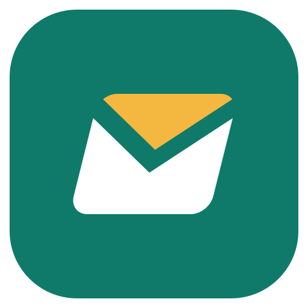
</p>

<h1 align="center">Citusmail</h1>

<p align="center">
  <b>Fast, private email that stays yours.</b><br>
  A free, open-source mail app for Android, Windows and Linux.<br>
  No ads, no subscriptions, no tracking, and no server of ours.
</p>

<p align="center">
  <a href="https://github.com/pawtaetoe/Citusmail/releases/latest"></a>
  <a href="LICENSE"></a>
  
  
</p>

<p align="center">
  <a href="https://citusmail.fluminaris.com"><b>Website</b></a> ·
  <a href="#download"><b>Download</b></a> ·
  <a href="#features">Features</a> ·
  <a href="PRIVACY.md">What leaves your device</a> ·
  <a href="#building-from-source">Build it yourself</a>
</p>

<p align="center">
  <picture>
    <source media="(prefers-color-scheme: dark)" srcset="docs/screenshots/readme_desktop_dark.png">
    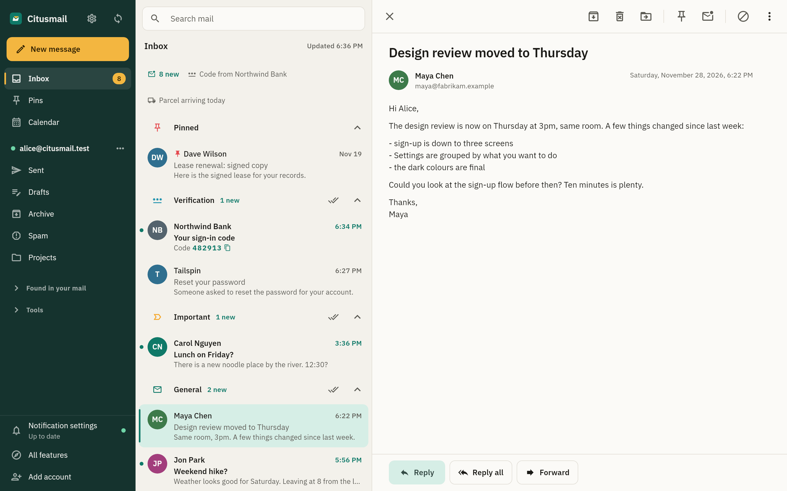
  </picture>
  &nbsp;
  <picture>
    <source media="(prefers-color-scheme: dark)" srcset="docs/screenshots/readme_phone_dark.png">
    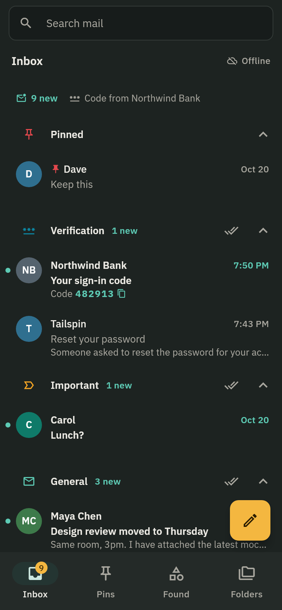
  </picture>
</p>

## Why Citusmail

<table>
<tr>
<td width="33%" valign="top">

**🔒 It all happens on your device**<br>
Sorting, scam checks and finding your subscriptions, parcels and trips
run on your phone or computer. Your mail is stored encrypted.

</td>
<td width="33%" valign="top">

**🙅 Nothing to sign up for**<br>
No Citusmail account, cloud, analytics or ads. The app talks to your own
mail provider, and to anything else only when you tap or turn it on.

</td>
<td width="33%" valign="top">

**✨ Mail that sorts itself**<br>
Codes, people, newsletters and notifications each in their place, and
what your mail says about bills, parcels and plans gathered for you.

</td>
</tr>
</table>

> **Exactly what leaves your device**, when, and why, is listed in
> [PRIVACY.md](PRIVACY.md). Loading an email's images, one-click
> unsubscribe and the optional link checks happen only when you tap them
> or turn them on.

## Features

### Inbox & focus

- **Smart Inbox**: mail sorted into Pinned, Verification, Important,
  General, Notifications and Newsletters, with what came while you were
  away on top.
- **Codes in the list**: sign-in codes show without opening the email,
  copied with a tap, and in the notification; old ones tidy themselves
  away.
- **Summary line**: one line over the inbox with what is new, the latest
  code and what is on today.
- **Pins** keep an email at hand, in their own tab. **Peek** at an email
  without opening it (press and hold, or Space): it stays unread.
- **Screener**: people writing for the first time wait for your OK before
  reaching your inbox.
- **Snooze**, **Send later** and **Remind me if no reply**: mail comes
  back when you choose, and sent email comes back if nobody answers.
- **AI sorting backup** (optional, off by default, with your own AI key):
  new mail the sorting rules can't place is sorted by the assistant, and
  the email says why; "Not right?" puts it back where you want it.

<table>
<tr>
<td align="center" width="33%"><br><sub>The Smart Inbox</sub></td>
<td align="center" width="33%">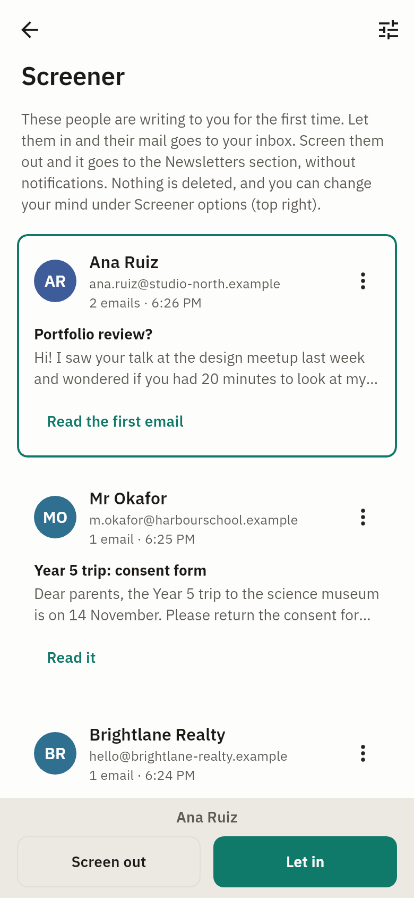<br><sub>The Screener for new senders</sub></td>
<td align="center" width="33%">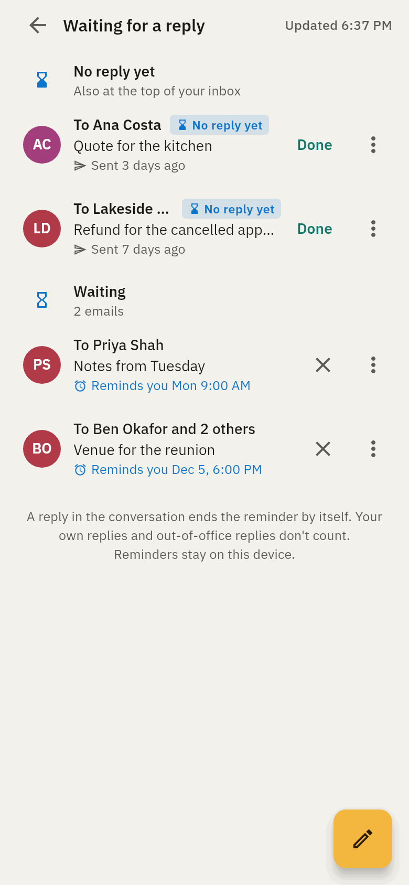<br><sub>Remind me if no reply</sub></td>
</tr>
</table>

### Found in your mail

Put together from your emails, on your device:

- **Subscriptions** and what they cost a year, a month and a day; bills
  and free trials coming up; each plan's own period (monthly, yearly,
  every 30 days, every 2 months) and next charge, and when a price went
  up.
- **Deliveries**: parcels on their way, and what can still be returned
  and by when.
- **Trips**: flights, hotels and bookings, put together into trips.
- **Appointments** and table bookings, and **Events**: tours, concerts,
  shows, films and meetings from your tickets and invitations.
- **Online accounts**: the websites and apps you signed up to.
- **Files**: every attachment people sent you, under Files in search.

<table>
<tr>
<td align="center" width="25%">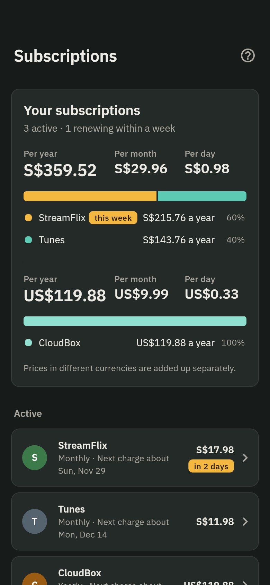<br><sub>Subscriptions, bills and trials</sub></td>
<td align="center" width="25%">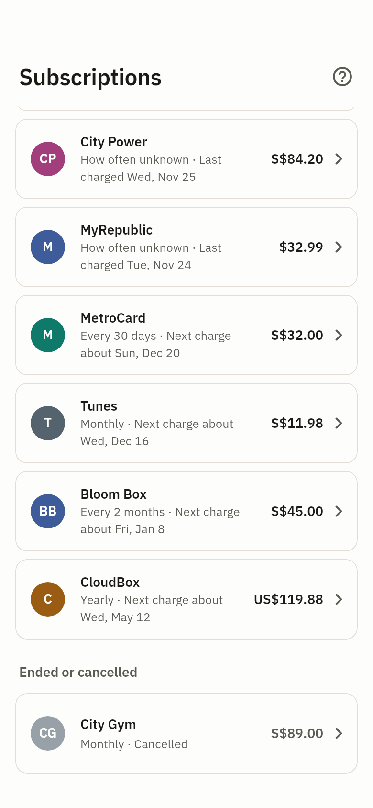<br><sub>Each plan's period and next charge</sub></td>
<td align="center" width="25%">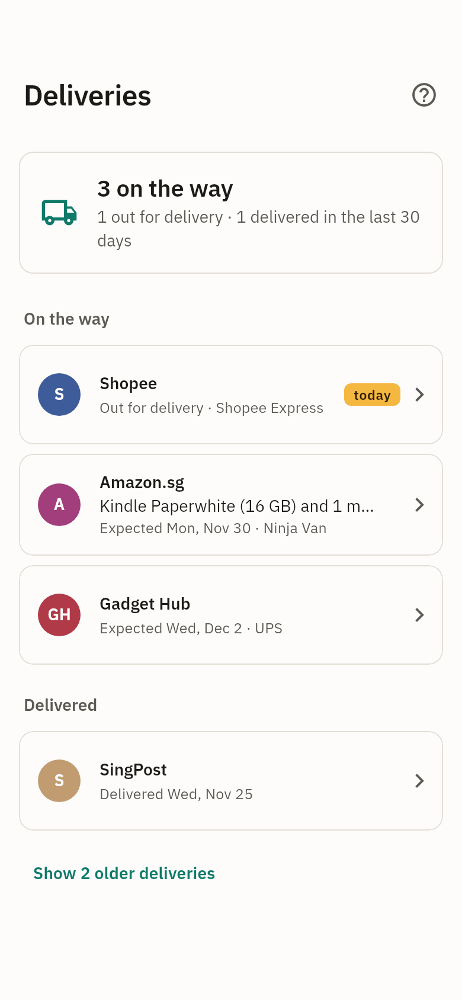<br><sub>Deliveries</sub></td>
<td align="center" width="25%">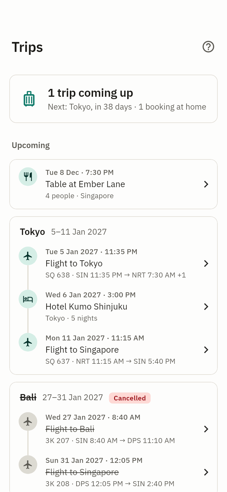<br><sub>Trips</sub></td>
</tr>
</table>

### Privacy & security

- **Scam warnings that explain** what is wrong: forged senders,
  lookalike links, outsiders writing in your company's name or a big
  brand's, hidden recipients and form "portals".
- **Privacy by default**: images and trackers blocked, read receipts
  never sent, tracking removed from links, one-tap unsubscribe, and
  blocking senders.
- **Privacy report**: the trackers, images and tracking tags kept from
  senders, and the read receipts not sent.
- **Read receipts you ask for** show on your sent email ("Read on
  Nov 6, 3:42 PM"), instead of arriving as notifications.
- **Locked down**: encrypted storage, passwords in the system keychain,
  app lock with PIN or fingerprint, end-to-end encrypted sync between
  your devices (your blocked senders, rules and sign-offs, and how the
  app handles your mail; notifications, the app lock and the theme stay
  on each device).
- **Optional link and file checks**, off until you turn them on: Google
  Safe Browsing (lists kept on the device, only short prefixes sent) and
  VirusTotal (your key; file fingerprints, never uploads).

<table>
<tr>
<td align="center" width="33%">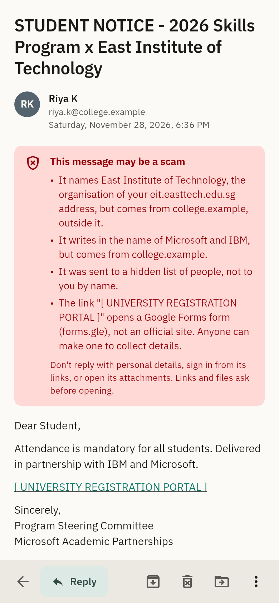<br><sub>Warnings that say why</sub></td>
<td align="center" width="33%">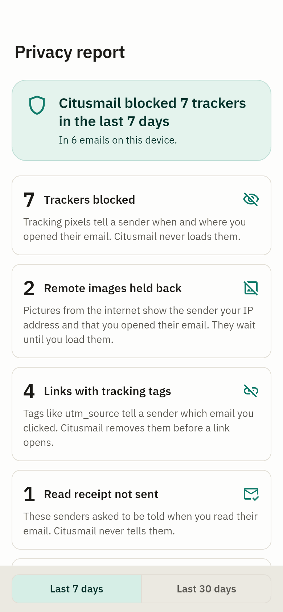<br><sub>What was kept from senders</sub></td>
<td align="center" width="33%">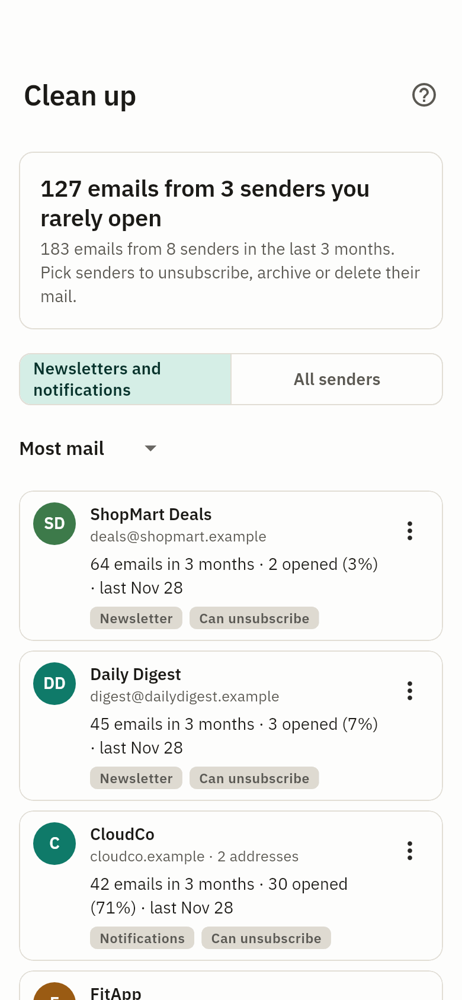<br><sub>Clean up busy senders</sub></td>
</tr>
</table>

<p align="center">
  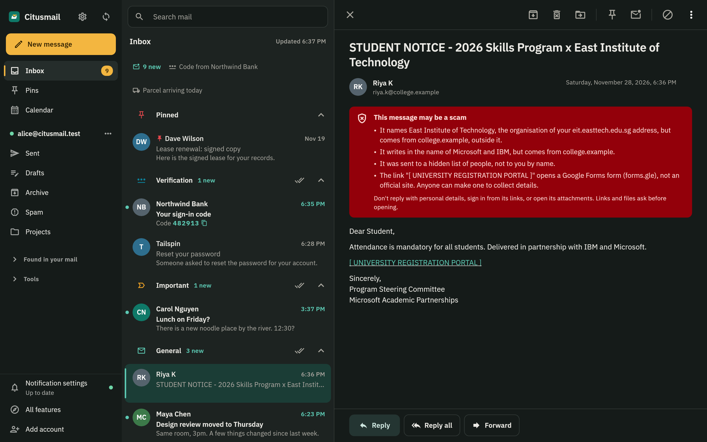
</p>

### Calendar & tools

- **Calendar**: trips, appointments, tickets and meetings from your mail,
  by day, with a tap to add one to your calendar app.
- **Meeting invitations** in your time zone, with Accept, Maybe and
  Decline.
- **Tools** in their own tab on phones, and in the sidebar on computers:
  everything found in your mail, **Clean up** (see who fills your inbox
  and clear out their mail at once) and the **Privacy report**.
- **Command bar** (Ctrl+K on computers): one box for emails, folders,
  settings and actions, from the keyboard.
- **Easy to find your way**: Settings grouped by what you want to do,
  with a search that knows your words ("dark mode", "PIN", "spam"); a
  short tip the first time a feature could help; "What's new" after an
  update; and every feature in one place, All features.

<table>
<tr>
<td align="center" width="33%">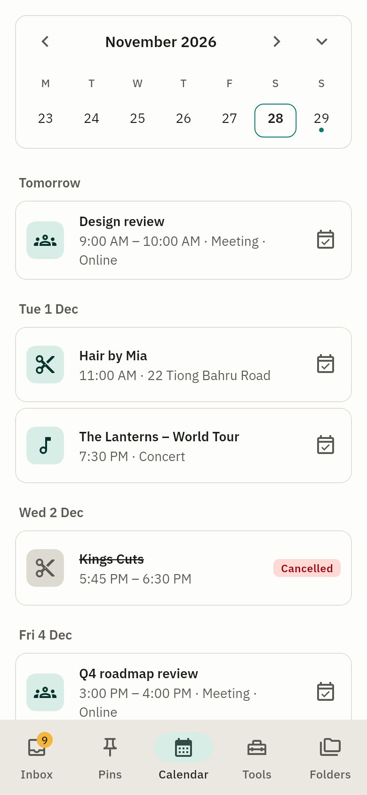<br><sub>Calendar</sub></td>
<td align="center" width="33%">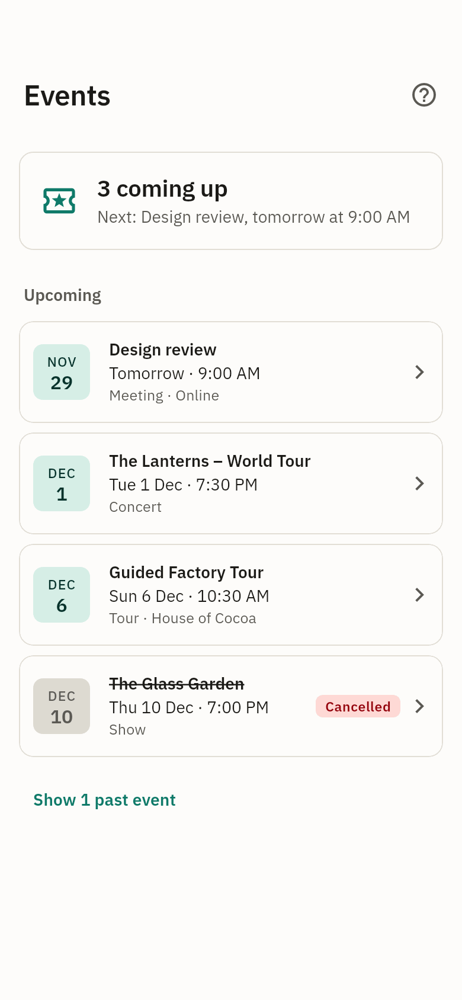<br><sub>Events from tickets and invitations</sub></td>
<td align="center" width="33%">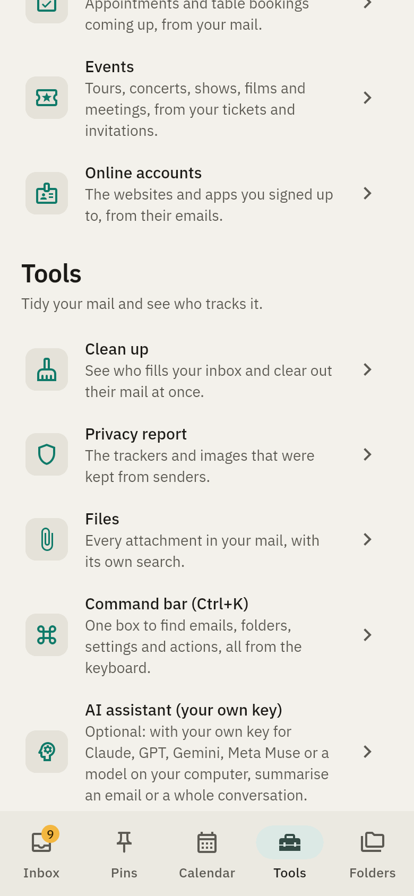<br><sub>The Tools tab</sub></td>
</tr>
</table>

### Writing, and AI only if you want it

- **Writing hints** while you write: when it is night for them, how
  quickly they usually reply, or "Did you mean" for a mistyped address.
- **Sign-offs**: keep several (a signature for work, a short one for
  replies), give each account its defaults, and switch or write a new
  one while you write.
- **An AI assistant, only if you want one**: off until you add your own
  key for Claude, GPT, Gemini (free tier), Meta Muse or any
  OpenAI-compatible endpoint (even a model on your own computer). Then
  "Summarise" gives the gist of an email or a whole conversation, with
  dates, amounts and what is asked of you, "Translate" shows a
  foreign-language email in yours, "Suggest replies" offers up to three
  short replies to start from (never sent for you). It can also draft or
  rework what you write, and tidy your inbox from a list you check
  before anything happens. It asks
  before it first sends anything, sends only the email you ask about,
  keeps the result on your device, and shows what it costs, with a
  monthly limit.
- **Ask your mail** (optional, off until you turn it on, with your own AI
  key): search with a question, like "When does my flight leave?", and
  get a short answer with the emails it comes from. The search runs on
  the device; only the few best matches are sent to the AI provider you
  chose.

### Platforms

- **Android, Windows and Linux**, from one code base. On phones, the
  Inbox, Pins, Calendar, Tools and Folders tabs and New message sit at
  the bottom, within reach of one thumb; on computers, three panes and
  keyboard shortcuts.
- **Every account in one inbox**: Gmail, Outlook / Microsoft 365 and any
  IMAP provider.
- **Add accounts from your phone**: on the computer, scan a code with the
  phone app and your accounts sign in there, sent straight over your
  Wi-Fi (or as a file), end-to-end encrypted.
- **On Android**: new mail at once, also while your phone sleeps, and
  the latest code in Quick Settings.
- **Light and dark**, following your system or your choice.

<table>
<tr>
<td align="center" width="50%"><br><sub>Light</sub></td>
<td align="center" width="50%">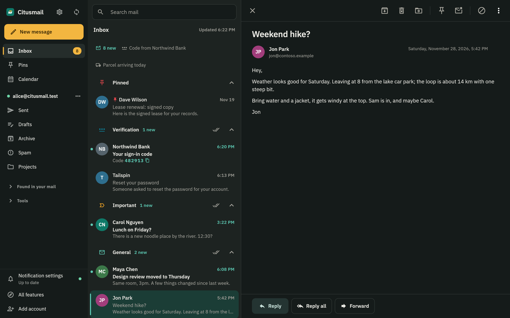<br><sub>Dark</sub></td>
</tr>
</table>

## Download

Free, with no account to create. Every file, its checksum and the
release notes are on the
**[latest release](https://github.com/pawtaetoe/Citusmail/releases/latest)**;
the [website](https://citusmail.fluminaris.com/#download) links each file
directly.

| Platform | Package | For |
| --- | --- | --- |
| **Android** | `.apk` | Phones and tablets (arm64, plus one for each other processor type) |
| **Linux** | `.deb` | Ubuntu, Debian, Mint and more |
| **Linux** | `.flatpak` | Any Linux with Flatpak |
| **Windows** | Installer (`.exe`) | Windows 10 and 11 |

## Privacy

Citusmail has no account with us and no server of ours. We don't
collect, receive, store, sell or share your data, and there is no
analytics, crash reporting or advertising: CI fails if any is added.

- [PRIVACY.md](PRIVACY.md): every place the app connects to, when, and
  what it sends.
- [Privacy policy](docs/privacy-policy.md) and
  [terms of service](docs/terms-of-service.md) (also on the website).
- [SECURITY.md](SECURITY.md): the rules every change follows, and how to
  report a vulnerability privately.

## FAQ

<details>
<summary><b>Is it really free?</b></summary>

Yes. No ads, no subscription and nothing paid to unlock. The code is
open source under the Mozilla Public License 2.0.

</details>

<details>
<summary><b>Which mail providers work?</b></summary>

Gmail, Outlook / Hotmail and Microsoft 365 (with their own sign-in), and
any provider with IMAP and SMTP. Connections are always encrypted.

</details>

<details>
<summary><b>Does my mail go through a Citusmail server?</b></summary>

No. There is no Citusmail server. The app connects to your own mail
provider, and to other services only when you tap something or turn it
on; [PRIVACY.md](PRIVACY.md) lists each one.

</details>

<details>
<summary><b>Do I need the AI features?</b></summary>

No. They are off until you add your own key, and the app works fully
without them. With a key, only the email you ask about is sent, to the
provider you chose.

</details>

<details>
<summary><b>Is there an iPhone or Mac version?</b></summary>

Not at the moment: Citusmail is built for Android, Windows and Linux.

</details>

<details>
<summary><b>How finished is it?</b></summary>

All planned features are built. Live checks against real Outlook and
Gmail accounts are still to run. The roadmap is in [PLAN.md](PLAN.md).

</details>

## For developers

Pure Dart mail protocols (IMAP, SMTP, MIME) written from scratch, a
Flutter app, and strict rules checked in CI: no analytics, every
dependency reviewed, and network code only in a few reviewed packages.
See [SECURITY.md](SECURITY.md) and [docs/architecture.md](docs/architecture.md).

### Building from source

Requirements: Flutter (stable, version pinned in
[.github/actions/setup-flutter/action.yml](.github/actions/setup-flutter/action.yml)).
Linux builds also need `clang ninja-build libgtk-3-dev libsecret-1-dev
liblzma-dev libsqlcipher-dev`.

```bash
flutter pub get                               # resolve the whole workspace
dart run repo_tools:check_dependencies        # dependency policy
dart run repo_tools:check_imports             # no network libraries in shipped code
dart format --set-exit-if-changed .           # formatting
flutter analyze                               # static analysis
(cd packages/mail_protocol && dart test)      # protocol tests
(cd packages/mail_store && dart test)         # storage tests
(cd packages/mail_compose && dart test)       # writing and sending
(cd packages/mail_sync && dart test)          # sync engine unit tests
(cd packages/mail_setup && dart test)         # account setup unit tests
(cd packages/mail_sort && dart test)          # sorting rules
(cd packages/mail_extract && dart test)       # schema.org data in mail
(cd packages/mail_view && dart test)          # safe mail display
(cd packages/mail_trust && dart test)         # phishing checks
(cd packages/mail_web && dart test)           # hardened HTTPS for one-click unsubscribe
(cd packages/mail_unsubscribe && dart test)   # unsubscribe methods
(cd packages/mail_appsync && dart test)       # app data sync format and encryption
(cd packages/mail_oauth && dart test)         # OAuth sign-in
(cd packages/mail_lookup && dart test)        # Safe Browsing and VirusTotal clients
(cd tool && dart test)                        # repository tool tests
(cd app && flutter test)                      # app tests
(cd app && flutter run -d linux)              # run on Linux
(cd app && flutter run --flavor github)       # run on Android (or --flavor play)
```

Windows builds need a Windows machine; CI builds them on every push.
Packages (.apk, Google Play .aab, .deb, Flatpak, Windows installer) and
release signing:
see [packaging/README.md](packaging/README.md).

Integration tests use local test mail servers; see
[test-server/README.md](test-server/README.md):

```bash
test-server/citusmailtest up && test-server/citusmailtest smoke
```

The website (citusmail.fluminaris.com) is built from this repository's
docs; see [site/README.md](site/README.md).

<details>
<summary><b>Screenshots</b></summary>

Every screen in this README and on the website is rendered from made-up
mail by the `readme` scenes of `app/screenshots/screens_test.dart`:

```bash
cd app && SCREEN_OUT=../docs/screenshots flutter test screenshots/screens_test.dart --plain-name readme
cd .. && python3 tool/shrink_screenshots.py docs/screenshots   # 256 colours, about a third of the size
```

</details>

<details>
<summary><b>Live checks against a real account</b></summary>

To check behaviour against a real provider, put your account settings (never
the password) in a git-ignored `live-test.env`, and the password in the
system keychain:

```bash
cp live-test.env.example live-test.env          # then edit it
secret-tool store --label="Citusmail test account" service citusmail-test account you@example.com
scripts/live-account-check.sh                   # read-only: TLS, capabilities, folders (curl; password accounts)
dart run repo_tools:live_check                  # read-only: same, using the app's own IMAP/SMTP code
dart run repo_tools:live_check --send           # also sends one message to the account itself
```

For an Outlook account, set `LIVE_SIGN_IN=microsoft` and
`LIVE_OAUTH_CLIENT_ID` (the app registration from
[packaging/README.md](packaging/README.md)) instead of a password. For
Google sign-in, `LIVE_SIGN_IN=google` with a Google client ID, and its
client secret in the keychain:
`secret-tool store --label="Citusmail test OAuth client" service citusmail-test-oauth-client account <client id>`. The first
run opens the browser to sign in; the tokens are then kept in the keychain
(service `citusmail-test-oauth`) and the check renews them as the app does.
`--sign-in-again` forgets them and signs in afresh.

</details>

<details>
<summary><b>Repository layout</b></summary>

```
.
├── app/                      Flutter app (UI, platform code)
│   ├── lib/
│   ├── screenshots/          The screens for this README and the website
│   └── test/
├── packages/
│   ├── mail_appsync/         App data shared between your devices, end-to-end
│                             encrypted (ChaCha20-Poly1305, sync code)
│   ├── mail_compose/         Writing mail: drafts, replies, sending with undo
│   ├── mail_extract/         schema.org data in shop and carrier mail (JSON-LD,
│                             microdata): parcels and orders, never run
│   ├── mail_lookup/          Optional outside checks, off until turned on: Google
│                             Safe Browsing (lists on the device, prefixes only)
│                             and VirusTotal (your key; file hashes, no uploads)
│   ├── mail_oauth/           OAuth 2.0 sign-in (Outlook, Google): PKCE, browser, tokens
│   ├── mail_protocol/        Pure Dart charsets, MIME, IMAP, SMTP and
│                             ManageSieve, written from scratch with no
│                             runtime dependencies
│   ├── mail_setup/           Account setup: discovery (Gmail built in) and
│                             login verification
│   ├── mail_sort/            Sorting into General, Verification codes,
│                             Newsletters, Notifications (header rules, plus
│                             what each sender's mail shows); finding codes
│   ├── mail_store/           Encrypted local storage (SQLite3MultipleCiphers)
│   ├── mail_sync/            Sync engine and background worker: folders, messages,
│                             offline queue, IDLE, opening messages, older mail
│   ├── mail_trust/           Phishing checks on the device: sender verification,
│                             lookalike domains, deceptive links, risky files
│   ├── mail_unsubscribe/     Unsubscribing: one-click (RFC 8058), email, web page
│   ├── mail_view/            Safe display: HTML and text to a document that
│                             cannot load anything; attachment names
│   └── mail_web/             The only HTTPS to servers named in mail: public
│                             addresses only, no cookies, no redirects
├── assets/icon/              App icon (SVG and PNG sizes)
├── docs/                     Privacy policy and terms (the website shows them)
│   └── screenshots/          Demo screens for this README and the website
├── packaging/                Linux .deb and Flatpak, Windows installer, signing
├── test-data/mail/           Sample emails shared by tests and the test server
├── test-server/              Local Dovecot + Postfix test servers (Podman/Docker)
├── site/                     The website (citusmail.fluminaris.com), on Vercel
├── scripts/                  Developer scripts (live account check)
├── tool/                     Repository checks run in CI (never shipped), and
│                             the icon and screenshot scripts
│   ├── bin/                  Command-line entry points
│   ├── lib/src/              Check logic, one class per concern
│   ├── test/
│   └── dependency_policy.txt Reviewed list of every allowed package
├── .github/                  CI workflows
├── analysis_options.yaml     Strict analyzer and lint rules shared by all
└── pubspec.yaml              Dart workspace root (one shared lock file)
```

</details>

## Contributing

Bug reports and pull requests are welcome on
[GitHub](https://github.com/pawtaetoe/Citusmail/issues). Please report
security problems privately instead, as [SECURITY.md](SECURITY.md)
explains.

Before you open a pull request, run the formatting, analysis and tests
above; CI runs them too. Every source file carries the MPL header.

**Adding a dependency**: every package, including indirect ones, must be
listed in [tool/dependency_policy.txt](tool/dependency_policy.txt) with a
reason. CI fails otherwise. Before adding a package that ships in the
app, read its source for network calls and prefer writing small things
ourselves.

## Licence

[Mozilla Public License 2.0](LICENSE). Every source file carries the MPL
header. Third-party data and its licences are listed in [NOTICE.md](NOTICE.md).
