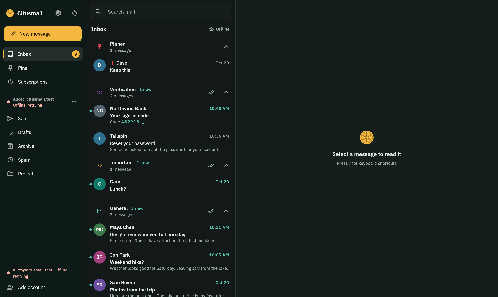
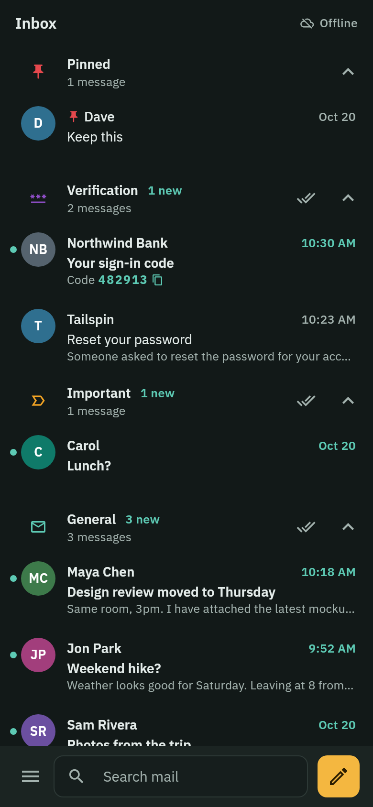
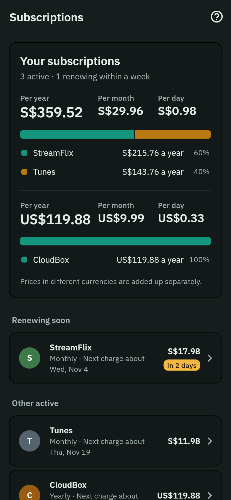
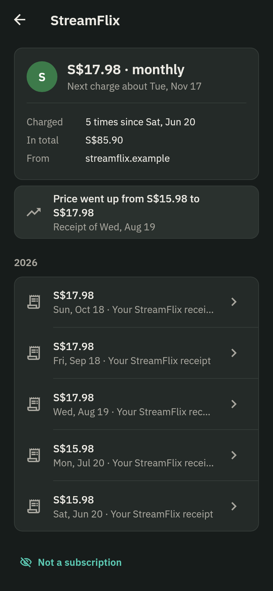
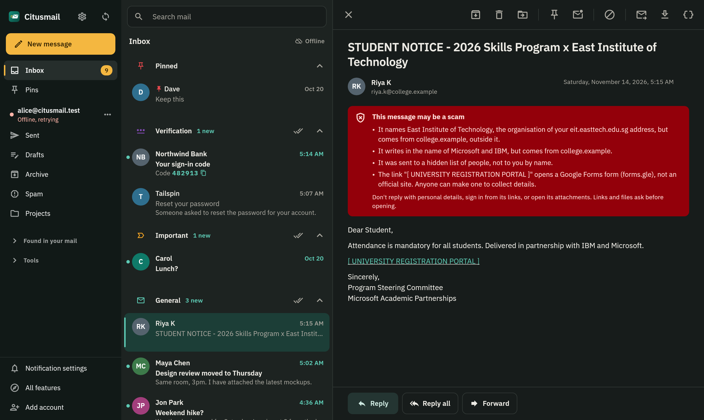
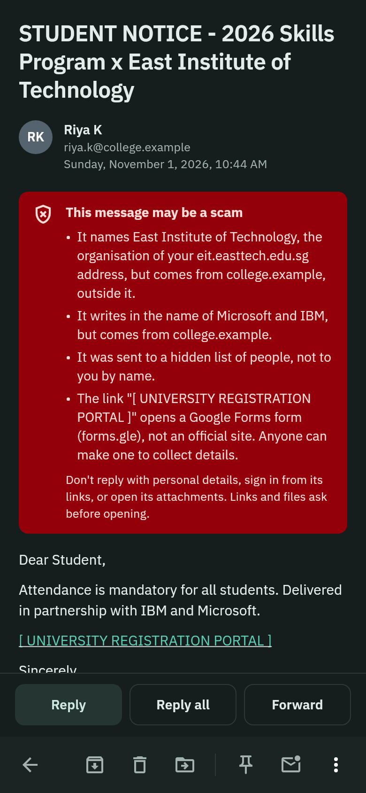
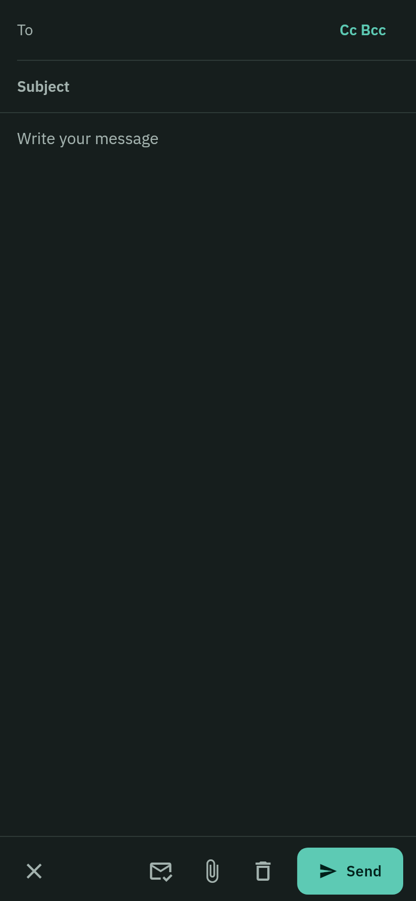
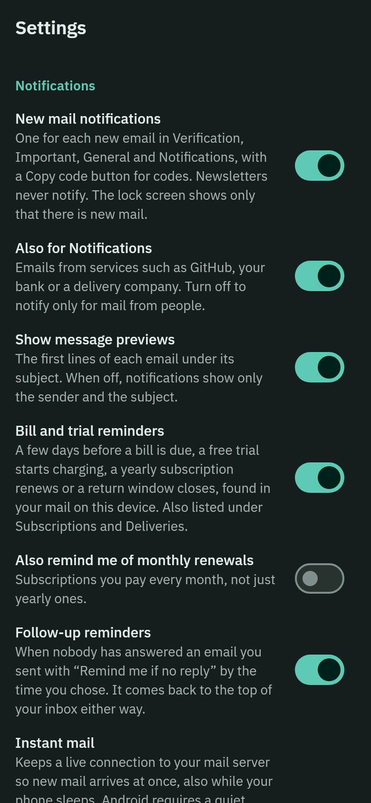

# Citusmail

A free, open source, cross-platform mail client inspired by Spark. No
subscriptions, no pop-ups, no "Sent from" signatures, no telemetry.

Website: **https://citusmail.fluminaris.com**

Status: all six milestones are built; live checks against real Outlook
and Gmail accounts are still to run, so it is not ready for daily use yet.
The roadmap and what each stage delivered are in [PLAN.md](PLAN.md).

Targets: Linux, Windows and Android first. The code is kept compatible with
macOS and iOS for later.

<p align="center">
  
  &nbsp;
  
</p>

## What sets it apart

### Your subscriptions, found in your mail

Most paid subscriptions send a receipt every time they charge you, but
they are easy to forget, and bank statements make monthly and yearly ones
hard to tell apart. Citusmail reads your receipts and renewal emails **on
your device** and lists every subscription it finds:

- **what you spend a year, a month and a day**, and how the year splits
  between your subscriptions, and which ones renew this week;
- for each one, the **price, how often it charges and the next charge**;
- **every past receipt** with what was charged, opening right in place,
  and when the **price went up**;
- **cancelled and lapsed** ones kept apart, so you can see what you
  stopped paying for.
- **coming up**: bills due (read from the bill: "due by 15 Nov", "pay
  within 7 days"), free trials about to start charging, and yearly
  renewals, with a reminder notification a few days before.

Nothing leaves your device; receipts you haven't opened are only
downloaded (from your own mail server, and they stay unread) when you
ask.

<p align="center">
  
  &nbsp;
  
</p>

### Also unlike most mail apps

- **Verification codes in the list**: one-time codes, sign-in links and
  password resets get their own section, and the code shows without
  opening the email.
- **Old codes tidy themselves up**: once you agree, codes, sign-in links
  and password resets older than a day (or a week) go to Archive or
  Trash, with Undo. Pinned ones stay.
- **A Screener for first-time senders** (off until you turn it on):
  mail from someone who has never written to you waits at the top of
  the inbox until you let them in or screen them out (to Newsletters,
  Notifications or Archive, never deleted), without notifications.
  Codes and replies to you always come straight in.
- **Snooze**: put an email away until later today, tonight, tomorrow,
  the weekend, next week or a time you pick. It comes back to the top of
  the inbox, unread, with one notification (or sooner, if someone
  replies). Snoozed mail waits in its own list, and snoozes follow you to
  your other devices with sync on. Nothing moves on the mail server.
- **Send later**: write now and choose when it goes (tomorrow morning or
  afternoon, Monday morning, or a time you pick). It waits in the Outbox
  on this device, where you can send it now, change the time, edit it or
  cancel it, and goes out once at its time, while Citusmail (or, on
  Android, its background check) runs; otherwise when Citusmail next
  runs.
- **Remind me if no reply**: on an email you send (or one already in
  Sent), choose in 1 day, 3 days, 1 week or a date. If nobody has answered
  by then, it comes back to the top of your inbox marked "No reply yet",
  with one notification in the daytime; a reply ends the reminder by
  itself (your own replies and out-of-office answers don't count). All
  reminders wait in "Waiting for a reply", where each can be cancelled.
  It stays on this device.
- **Phishing checks that read the message**: besides forged senders and
  lookalike links, it warns when an outsider writes in the name of your
  own school or company, or a big brand, especially with hidden
  recipients or a form "portal".
- **No server of ours**: everything above runs on your device; there is
  no Citusmail account, cloud or tracking.

## Screenshots

<p align="center">
  
</p>

<p align="center">
  
  &nbsp;
  
  &nbsp;
  
</p>

On phones, the menu, search, New message, the message actions and Send
are at the bottom of the screen, within reach of one thumb.

## Features

- **Smart Inbox**: mail sorted on your device into Pinned, Verification,
  Important, General, Notifications and Newsletters. Verification codes
  show in the list, copied with a tap.
- **Several accounts** in one inbox: any IMAP/SMTP provider, Gmail (app
  password or Google sign-in) and Outlook / Microsoft 365 (Microsoft
  sign-in).
- **Phishing checks** on the device: unverified senders, lookalike
  domains, deceptive links, risky attachments, and outsiders writing in
  the name of your own institution or a big company (with hidden
  recipient lists and free-form "portals"). Optional Google Safe
  Browsing and VirusTotal, under Settings > Advanced.
- **Privacy**: images and trackers blocked, read receipts never sent,
  tracking parameters removed from links, one-tap unsubscribe (with the
  unsubscribe address checked too), blocking senders.
- **Privacy report**: what was kept from senders in the last 7 or 30
  days (trackers, remote images, tracking tags on links, read receipts,
  scam warnings) and the senders that track you most, counted on your
  device.
- **Attachments**: every file people sent you in one searchable list
  (PDFs, photos, documents, spreadsheets), from all accounts and
  folders, without downloading your mail. Tap one to open its email or
  save it.
- **Writing mail**: drafts, replies, undo send, custom folders and rules
  (also as server-side Sieve rules).
- **Meeting invitations**: Outlook, Google Calendar, Zoom and other
  invitations show as a card with the date in your time zone, the
  place and the meeting link. Accept, Maybe or Decline answers the
  organizer (and only them), with undo; "Open in calendar app" adds the
  event to your own calendar.
- **Every message, whole**: save it as an .eml file, see its original
  headers and source, or forward it as an attachment.
- **Subscriptions**: the paid subscriptions found in your receipts and
  renewal mail, with what each costs, how often, the next charge and
  every past receipt (see above).
- **Your accounts**: the online services you have an account with, found
  in welcome emails, sign-in codes, password resets and security alerts
  on your device, with the address each one uses. Handy after a data
  breach, when you change address, or to close accounts you no longer
  use.
- **Deliveries**: every shipped order found in your mail, with its shop,
  items, carrier, tracking number and latest status, what's on the way
  first with its expected date; "Track" opens the carrier's page after
  asking.
- **Trips**: flights, hotels, trains, buses, rental cars, restaurant
  tables and event tickets found in your booking emails, put together
  into trips ("Tokyo, 12–18 Dec") with a timeline in local times, on
  your device and offline. Copy the booking reference with a tap, add a
  booking to your calendar, and see cancellations and schedule changes.
- **Return-by dates**: under Deliveries, what you can still return and
  until when, read from the return policy in order confirmations and
  receipts ("30-day returns", "return by 15 Dec"), with a reminder three
  days before the window closes; mark one "Returned" or "Keeping it".
- **Bill and trial reminders**: a notification a few days before a bill
  is due, a free trial starts charging or a yearly subscription renews,
  found in your mail on the device; mark one "Done" and it stays quiet.
- **Notifications that show what arrived**: one per new email with the
  sender, subject and first lines (bundled per account on Android), and
  verification codes in the title with a Copy code button. With the app
  lock on, only "New mail".
- **Clean up**: the senders who fill your inbox and the ones you rarely
  open, worked out on your device (not on someone's server), with
  unsubscribe, archive or delete everything from them, block, or keep.
- **New mail on Android** checked about every 5 minutes in the background,
  or at once with Instant mail (in the APK from the GitHub releases; the
  Google Play version leaves Instant mail out).
- **Encrypted everywhere**: local database, passwords in the system
  keychain, end-to-end encrypted sync of settings between your devices,
  app lock with PIN or fingerprint.

## Principles

1. **Privacy.** The app talks only to your own mail servers, plus outside
   services you explicitly switch on. No analytics, no crash reporting, no ads.
   See [PRIVACY.md](PRIVACY.md), the
   [privacy policy](docs/privacy-policy.md) and the
   [terms of service](docs/terms-of-service.md).
2. **Security.** Encrypted connections only, passwords in the system
   keychain, encrypted local storage, and mail that can't run code or load
   remote content. See [SECURITY.md](SECURITY.md).
3. **Correctness and reliability first.** Readable code, tested behaviour,
   and no shortcuts that trade safety for speed.

## Repository layout

```
.
├── app/                      Flutter app (UI, platform code)
│   ├── lib/
│   └── test/
├── packages/
│   ├── mail_appsync/         App data shared between your devices, end-to-end
│                             encrypted (ChaCha20-Poly1305, sync code)
│   ├── mail_compose/         Writing mail: drafts, replies, sending with undo
│   ├── mail_extract/         schema.org data in shop and carrier mail (JSON-LD,
│                             microdata): parcels and orders, never run
│   ├── mail_lookup/          Optional outside checks, off until turned on: Google
│                             Safe Browsing (lists on the device, prefixes only)
│                             and VirusTotal (your key; file hashes, no uploads)
│   ├── mail_oauth/           OAuth 2.0 sign-in (Outlook, Google): PKCE, browser, tokens
│   ├── mail_protocol/        Pure Dart charsets, MIME, IMAP, SMTP and
│                             ManageSieve, written from scratch with no
│                             runtime dependencies
│   ├── mail_setup/           Account setup: discovery (Gmail built in) and
│                             login verification
│   ├── mail_sort/            Sorting into General, Verification codes,
│                             Newsletters, Notifications (header rules, plus
│                             what each sender's mail shows); finding codes
│   ├── mail_store/           Encrypted local storage (SQLite3MultipleCiphers)
│   ├── mail_sync/            Sync engine and background worker: folders, messages,
│                             offline queue, IDLE, opening messages, older mail
│   ├── mail_trust/           Phishing checks on the device: sender verification,
│                             lookalike domains, deceptive links, risky files
│   ├── mail_unsubscribe/     Unsubscribing: one-click (RFC 8058), email, web page
│   ├── mail_view/            Safe display: HTML and text to a document that
│                             cannot load anything; attachment names
│   └── mail_web/             The only HTTPS to servers named in mail: public
│                             addresses only, no cookies, no redirects
├── assets/icon/              App icon (SVG and PNG sizes)
├── docs/                     Privacy policy and terms (the website shows them)
│   └── screenshots/          Demo screens for this README and the website
├── packaging/                Linux .deb and Flatpak, Windows installer, signing
├── test-data/mail/           Sample emails shared by tests and the test server
├── test-server/              Local Dovecot + Postfix test servers (Podman/Docker)
├── site/                     The website (citusmail.fluminaris.com), on Vercel
├── scripts/                  Developer scripts (live account check)
├── tool/                     Repository checks run in CI (never shipped)
│   ├── bin/                  Command-line entry points
│   ├── lib/src/              Check logic, one class per concern
│   ├── test/
│   └── dependency_policy.txt Reviewed list of every allowed package
├── .github/                  CI workflows
├── analysis_options.yaml     Strict analyzer and lint rules shared by all
└── pubspec.yaml              Dart workspace root (one shared lock file)
```

More packages are added as milestones need them.

## Building

Requirements: Flutter (stable, version pinned in
[.github/actions/setup-flutter/action.yml](.github/actions/setup-flutter/action.yml)).
Linux builds also need `clang ninja-build libgtk-3-dev libsecret-1-dev
liblzma-dev libsqlcipher-dev`.

```bash
flutter pub get                               # resolve the whole workspace
dart run repo_tools:check_dependencies        # dependency policy
dart run repo_tools:check_imports             # no network libraries in shipped code
dart format --set-exit-if-changed .           # formatting
flutter analyze                               # static analysis
(cd packages/mail_protocol && dart test)      # protocol tests
(cd packages/mail_store && dart test)         # storage tests
(cd packages/mail_compose && dart test)       # writing and sending
(cd packages/mail_sync && dart test)          # sync engine unit tests
(cd packages/mail_setup && dart test)         # account setup unit tests
(cd packages/mail_sort && dart test)          # sorting rules
(cd packages/mail_extract && dart test)       # schema.org data in mail
(cd packages/mail_view && dart test)          # safe mail display
(cd packages/mail_trust && dart test)         # phishing checks
(cd packages/mail_web && dart test)           # hardened HTTPS for one-click unsubscribe
(cd packages/mail_unsubscribe && dart test)   # unsubscribe methods
(cd packages/mail_appsync && dart test)       # app data sync format and encryption
(cd packages/mail_oauth && dart test)         # OAuth sign-in
(cd packages/mail_lookup && dart test)        # Safe Browsing and VirusTotal clients
(cd tool && dart test)                        # repository tool tests
(cd app && flutter test)                      # app tests
(cd app && flutter run -d linux)              # run on Linux
(cd app && flutter run --flavor github)       # run on Android (or --flavor play)
```

The demo screens above are rendered from made-up mail:
`cd app && SCREEN_OUT=../docs/screenshots flutter test screenshots/screens_test.dart --plain-name readme`.

Windows builds need a Windows machine; CI builds them on every push.
Packages (.apk, Google Play .aab, .deb, Flatpak, Windows installer) and
release signing:
see [packaging/README.md](packaging/README.md).

Integration tests use local test mail servers; see
[test-server/README.md](test-server/README.md):

```bash
test-server/citusmailtest up && test-server/citusmailtest smoke
```

### Live checks against a real account

To check behaviour against a real provider, put your account settings (never
the password) in a git-ignored `live-test.env`, and the password in the
system keychain:

```bash
cp live-test.env.example live-test.env          # then edit it
secret-tool store --label="Citusmail test account" service citusmail-test account you@example.com
scripts/live-account-check.sh                   # read-only: TLS, capabilities, folders (curl; password accounts)
dart run repo_tools:live_check                  # read-only: same, using the app's own IMAP/SMTP code
dart run repo_tools:live_check --send           # also sends one message to the account itself
```

For an Outlook account, set `LIVE_SIGN_IN=microsoft` and
`LIVE_OAUTH_CLIENT_ID` (the app registration from
[packaging/README.md](packaging/README.md)) instead of a password. For
Google sign-in, `LIVE_SIGN_IN=google` with a Google client ID, and its
client secret in the keychain:
`secret-tool store --label="Citusmail test OAuth client" service citusmail-test-oauth-client account <client id>`. The first
run opens the browser to sign in; the tokens are then kept in the keychain
(service `citusmail-test-oauth`) and the check renews them as the app does.
`--sign-in-again` forgets them and signs in afresh.

## Adding a dependency

Every package, including indirect ones, must be listed in
[tool/dependency_policy.txt](tool/dependency_policy.txt) with a reason. CI
fails otherwise. Before adding a package that ships in the app, read its
source for network calls and prefer writing small things ourselves.

## Licence

[Mozilla Public License 2.0](LICENSE). Every source file carries the MPL
header. Third-party data and its licences are listed in [NOTICE.md](NOTICE.md).
