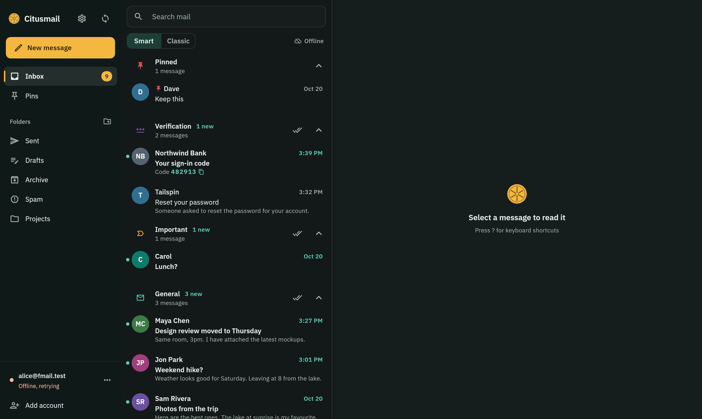
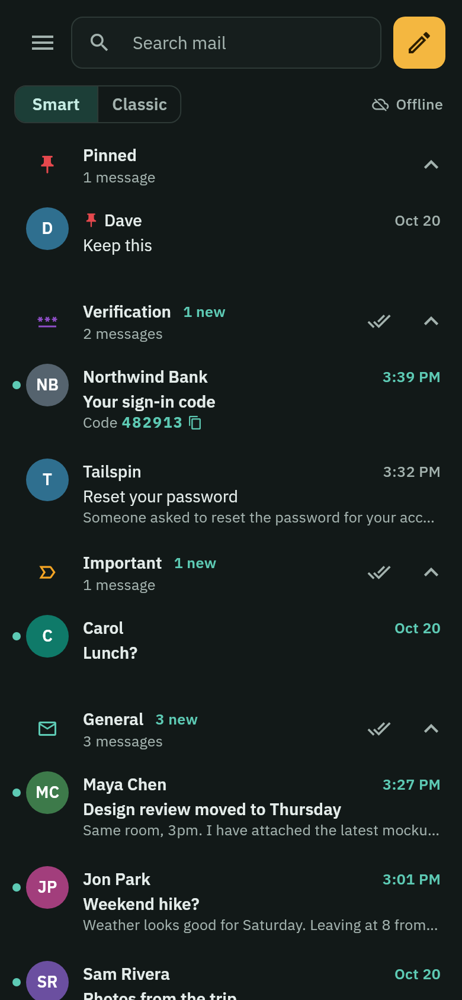

# Citusmail

A free, open source, cross-platform mail client inspired by Spark. No
subscriptions, no pop-ups, no "Sent from" signatures, no telemetry.

Status: all six milestones are built; live checks against real Outlook
and Gmail accounts are still to run, so it is not ready for daily use yet.
The roadmap and what each stage delivered are in [PLAN.md](PLAN.md).

Targets: Linux, Windows and Android first. The code is kept compatible with
macOS and iOS for later.

<p align="center">
  
  &nbsp;
  
</p>

## Features

- **Smart Inbox**: mail sorted on your device into Pinned, Verification,
  Important, General, Notifications and Newsletters. Verification codes
  show in the list, copied with a tap.
- **Several accounts** in one inbox: any IMAP/SMTP provider, Gmail (app
  password or Google sign-in) and Outlook / Microsoft 365 (Microsoft
  sign-in).
- **Phishing checks** on the device: unverified senders, lookalike
  domains, deceptive links, risky attachments. Optional Google Safe
  Browsing and VirusTotal.
- **Privacy**: images and trackers blocked, read receipts never sent,
  tracking parameters removed from links, one-tap unsubscribe (with the
  unsubscribe address checked too), blocking senders.
- **Writing mail**: drafts, replies, undo send, custom folders and rules
  (also as server-side Sieve rules).
- **Encrypted everywhere**: local database, passwords in the system
  keychain, end-to-end encrypted sync of settings between your devices,
  app lock with PIN or fingerprint.

## Principles

1. **Privacy.** The app talks only to your own mail servers, plus outside
   services you explicitly switch on. No analytics, no crash reporting, no ads.
   See [PRIVACY.md](PRIVACY.md).
2. **Security.** Encrypted connections only, passwords in the system
   keychain, encrypted local storage, and mail that can't run code or load
   remote content. See [SECURITY.md](SECURITY.md).
3. **Correctness and reliability first.** Readable code, tested behaviour,
   and no shortcuts that trade safety for speed.

## Repository layout

```
.
├── app/                      Flutter app (UI, platform code)
│   ├── lib/
│   └── test/
├── packages/
│   ├── mail_appsync/         App data shared between your devices, end-to-end
│                             encrypted (ChaCha20-Poly1305, sync code)
│   ├── mail_compose/         Writing mail: drafts, replies, sending with undo
│   ├── mail_lookup/          Optional outside checks, off until turned on: Google
│                             Safe Browsing (lists on the device, prefixes only)
│                             and VirusTotal (your key; file hashes, no uploads)
│   ├── mail_oauth/           OAuth 2.0 sign-in (Outlook, Google): PKCE, browser, tokens
│   ├── mail_protocol/        Pure Dart charsets, MIME, IMAP, SMTP and
│                             ManageSieve, written from scratch with no
│                             runtime dependencies
│   ├── mail_setup/           Account setup: discovery (Gmail built in) and
│                             login verification
│   ├── mail_sort/            Sorting into General, Verification codes,
│                             Newsletters, Notifications (header rules, plus
│                             what each sender's mail shows); finding codes
│   ├── mail_store/           Encrypted local storage (SQLite3MultipleCiphers)
│   ├── mail_sync/            Sync engine and background worker: folders, messages,
│                             offline queue, IDLE, opening messages, older mail
│   ├── mail_trust/           Phishing checks on the device: sender verification,
│                             lookalike domains, deceptive links, risky files
│   ├── mail_unsubscribe/     Unsubscribing: one-click (RFC 8058), email, web page
│   ├── mail_view/            Safe display: HTML and text to a document that
│                             cannot load anything; attachment names
│   └── mail_web/             The only HTTPS to servers named in mail: public
│                             addresses only, no cookies, no redirects
├── assets/icon/              App icon (SVG and PNG sizes)
├── docs/screenshots/         Demo screens for this README
├── packaging/                Linux .deb and Flatpak, Windows installer, signing
├── test-data/mail/           Sample emails shared by tests and the test server
├── test-server/              Local Dovecot + Postfix test servers (Podman/Docker)
├── scripts/                  Developer scripts (live account check)
├── tool/                     Repository checks run in CI (never shipped)
│   ├── bin/                  Command-line entry points
│   ├── lib/src/              Check logic, one class per concern
│   ├── test/
│   └── dependency_policy.txt Reviewed list of every allowed package
├── .github/                  CI workflows
├── analysis_options.yaml     Strict analyzer and lint rules shared by all
└── pubspec.yaml              Dart workspace root (one shared lock file)
```

More packages are added as milestones need them.

## Building

Requirements: Flutter (stable, version pinned in
[.github/actions/setup-flutter/action.yml](.github/actions/setup-flutter/action.yml)).
Linux builds also need `clang ninja-build libgtk-3-dev libsecret-1-dev
liblzma-dev libsqlcipher-dev`.

```bash
flutter pub get                               # resolve the whole workspace
dart run repo_tools:check_dependencies        # dependency policy
dart run repo_tools:check_imports             # no network libraries in shipped code
dart format --set-exit-if-changed .           # formatting
flutter analyze                               # static analysis
(cd packages/mail_protocol && dart test)      # protocol tests
(cd packages/mail_store && dart test)         # storage tests
(cd packages/mail_compose && dart test)       # writing and sending
(cd packages/mail_sync && dart test)          # sync engine unit tests
(cd packages/mail_setup && dart test)         # account setup unit tests
(cd packages/mail_sort && dart test)          # sorting rules
(cd packages/mail_view && dart test)          # safe mail display
(cd packages/mail_trust && dart test)         # phishing checks
(cd packages/mail_web && dart test)           # hardened HTTPS for one-click unsubscribe
(cd packages/mail_unsubscribe && dart test)   # unsubscribe methods
(cd packages/mail_appsync && dart test)       # app data sync format and encryption
(cd packages/mail_oauth && dart test)         # OAuth sign-in
(cd packages/mail_lookup && dart test)        # Safe Browsing and VirusTotal clients
(cd tool && dart test)                        # repository tool tests
(cd app && flutter test)                      # app tests
(cd app && flutter run -d linux)              # run on Linux
```

The demo screens above are rendered from made-up mail:
`cd app && SCREEN_OUT=../docs/screenshots flutter test screenshots/screens_test.dart --plain-name readme`.

Windows builds need a Windows machine; CI builds them on every push.
Packages (.apk, .deb, Flatpak, Windows installer) and release signing:
see [packaging/README.md](packaging/README.md).

Integration tests use local test mail servers; see
[test-server/README.md](test-server/README.md):

```bash
test-server/fmailtest up && test-server/fmailtest smoke
```

### Live checks against a real account

To check behaviour against a real provider, put your account settings (never
the password) in a git-ignored `live-test.env`, and the password in the
system keychain:

```bash
cp live-test.env.example live-test.env          # then edit it
secret-tool store --label="Fmail test account" service fmail-test account you@example.com
scripts/live-account-check.sh                   # read-only: TLS, capabilities, folders (curl; password accounts)
dart run repo_tools:live_check                  # read-only: same, using the app's own IMAP/SMTP code
dart run repo_tools:live_check --send           # also sends one message to the account itself
```

For an Outlook account, set `LIVE_SIGN_IN=microsoft` and
`LIVE_OAUTH_CLIENT_ID` (the app registration from
[packaging/README.md](packaging/README.md)) instead of a password. For
Google sign-in, `LIVE_SIGN_IN=google` with a Google client ID, and its
client secret in the keychain:
`secret-tool store --label="Fmail test OAuth client" service fmail-test-oauth-client account <client id>`. The first
run opens the browser to sign in; the tokens are then kept in the keychain
(service `fmail-test-oauth`) and the check renews them as the app does.
`--sign-in-again` forgets them and signs in afresh.

## Adding a dependency

Every package, including indirect ones, must be listed in
[tool/dependency_policy.txt](tool/dependency_policy.txt) with a reason. CI
fails otherwise. Before adding a package that ships in the app, read its
source for network calls and prefer writing small things ourselves.

## Licence

[Mozilla Public License 2.0](LICENSE). Every source file carries the MPL
header. Third-party data and its licences are listed in [NOTICE.md](NOTICE.md).
